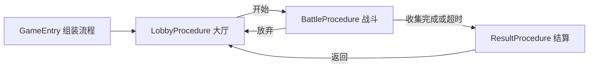

# 架构、生命周期、FSM / Procedure 与实体管理

基线：Unity 2022.3 LTS、Windows x64、HybridCLR。已完成 P1 1～5 修复、FSM / Procedure 和实体管理；Demo 使用独立流程与热更新实体逻辑。

## 分层与模块管理

```text
Contracts（AOT）   IModule / IModuleRegistry / IGameEntry / 日志、序列化、文件传输接口
       ↑
Core（AOT）        ModuleHost / Fsm<T> / ProcedureManager / EntityManager<T> / StateScope
       ↑
Runtime（AOT）     EntityService / 多包 ResourceService / UiService / AudioService / 场景 / GameRuntime
       ↑
Bootstrap（AOT）   校验更新 → 加载 DLL → 创建入口 → 注册 → 启动 → 统一关闭
       ↓ 通过共享 IGameEntry 契约调用，不引用 HotUpdate 程序集
HotUpdate         GameEntry / DemoServices / Lobby、Battle、ResultProcedure / EnergyOrbLogic
```

`GameRuntime` 显式持有基础服务，不再持有球池实例、成绩、业务存档或模拟排行榜。业务服务由 `DemoServices` 统一拥有；游戏入口通过构造注入取得运行环境、创建业务模块，在 `RegisterModules` 中登记。模块列表启动后冻结。

`ModuleHost` 使用 ID 与显式依赖做拓扑排序，拒绝缺失依赖与循环依赖。正常链路为：

```text
启动顺序：resources → presentation → scenes → ui → entities → audio → demo.gameplay → game.entry
关闭顺序：game.entry → demo.gameplay → audio → entities → ui → scenes → presentation → resources
每个模块：InitializeAsync → StartAsync → StopAsync → Dispose
```

`presentation`、`scenes`、`entities`、`audio` 共同依赖 resources，ui 依赖 resources/presentation，demo.gameplay 依赖 entities/ui/audio/scenes，上面是当前注册得到的拓扑顺序。`game.entry` 依赖全部模块，先等待入口的业务任务与实体回收结束，再关闭业务服务与基础服务。测试参数才会插入 `demo.shutdown-probe`，普通游戏没有该探针。

没有中央 `Update` 遍历模块；`ModuleHost` 只管理生命周期。`DemoController.Update` 只将帧时间传给 `ProcedureManager.Tick`，由 `Fsm` 调用当前已进入完毕的流程；进入、退出及切换期间不更新任何流程。

## FSM 与游戏流程



| 类型 | 职责 |
|---|---|
| `Fsm<TOwner>` / `FsmState<TOwner>` | 通用状态机：按类型显式注册、异步切换、只更新当前状态、停止与错误处理 |
| `ProcedureManager` / `ProcedureBase` | 用一个 FSM 管理游戏流程；不继承 IModule，不加入模块轮询 |
| `StateScope` | 每次进入流程创建新作用域，拥有任务、取消令牌、订阅和资源；离开后不能复用 |
| `LobbyProcedure` | 大厅场景、设置入口、更新暂存任务、进入战斗请求 |
| `BattleProcedure` | 战斗场景、实体生成编排、输入路由、倒计时、计分事件订阅，输出不可变的 RoundResult |
| `ResultProcedure` | 加载自己的 Arena 场景，保存结果、排行榜提交、返回大厅请求；退出时等待提交任务取消完成 |
| `DemoView` | 继承 UiFormLogic，创建 Demo.Main / Demo.Settings 内容；UiService 管窗口生命周期，回调校验所属作用域，避免过期按钮仍能操作新流程 |
| `DemoController` | Unity 帧驱动、调用独立的 DemoValidation；不再包含大厅/战斗/结算逻辑 |

冷启动的验签、DLL 加载与模块初始化仍由 AOT Bootstrap 执行；加载热更入口后开始游戏流程。场景加载属于各流程的异步 Enter 阶段，不额外创建无独立行为的加载状态。Boot 是唯一内置场景，Lobby/Arena 来自当前版本的场景资源包。流程首先登记场景租约，随后登记 UI、音频与实体 owner；作用域逆序清理时，场景最后卸载，包与依赖最后释放。结算重新取得自己的 Arena，不继承已退出战斗的场景所有权。

### 切换顺序与异步约束

1. 接受切换后立即禁止旧作用域继续接收任务、事件和 UI 操作，并取消其令牌。
2. 等待通过 `scope.Run` 登记的全部任务结束。即使任务暂时不支持取消，也不提前进入下一流程。
3. 逆序释放 `scope.Own` 的资源和 `scope.Subscribe` 的订阅，然后等待旧流程 `ExitAsync`（例如归还球实例）。
4. 创建新作用域并等待新流程 `EnterAsync`；成功后才恢复每帧更新。

作用域的任务必须在所属上下文（Unity 主线程）登记；需要后台计算时，在登记的任务中等待后台结果，回主线程再访问 Unity。资源获取和订阅应放在 Enter，而非构造函数。

流程自身的按钮、事件和任务使用 `RequestChange<T>(scope)`，这是不返回切换 Task 的请求接口；旧任务先返回，状态机再等待其退出。`ChangeAsync<T>` 供入口与外部编排使用。框架检测并拒绝作用域任务直接调用本 FSM 的 ChangeAsync / StopAsync，防止自己等待自己。外部代码也不能把 FSM.Transition 包装成旧作用域中的待完成任务。

切换期间只接受第一个流程请求，后续 Request 返回 false；外部重叠 ChangeAsync 抛出异常，不排队。过期作用域不能请求切换；重复切换到当前状态不会重新 Enter。停止期间取消正在 Enter 的作用域，等待进入任务结束后清理；重复 Stop 共用同一个任务。

后台业务任务失败会记录 `state.task.failed`，不会因此跳过等待或资源清理。Enter/Exit/资源释放失败则停止继续切换，记录异常并清理部分进入的状态；不会继续启动下一个状态。Update 的业务异常应由业务流程处理，当前通用 FSM 不自动重启失败流程。

长时间无视取消的任务会阻止切换；框架不会强制销毁它仍可能访问的对象。应用退出时仍受 ModuleHost 的 5 秒关闭监测约束。流程操作应向网络等外部服务传递取消和超时。

`DemoValidation` 是入口拥有的跨流程测试编排，不登记到某一个流程的作用域；退出应用时会取消并等待它。它覆盖旧流程延迟任务、过期 UI 回调、结算请求取消，以及完整游戏流程。

## 生命周期与实体改造

实体层由 EntityService 管理 ID、分组、异步创建、实例复用与回收，EntityOwner 接入流程异步清理；实体任务结束后再关闭流程界面。具体生命周期、使用示例、与上游的对应关系见 [实体管理说明](ENTITY.md)。

| 顺序 | 原问题 | 当前处理 |
|---|---|---|
| P1-1 | 启动与停止交错，释放后继续启动或重复清理 | 启动、停止、清理各自共享一个任务；停止先取消并等待启动；每个异步启动阶段后检查取消；清理只执行一次 |
| P1-2 | 普通启动异常没有统一释放 | 普通启动与自检共用 `ShutdownAsync`；等待启动收敛后逆序关闭模块，检查订阅、资源租约和 UI 数量 |
| P1-3 | 普通退出不等待异步 Stop | `Application.wantsToQuit` 首次拦截退出；等待共享关闭任务成功后再次退出，失败记录日志并阻止受控退出 |
| P1-4 | AOT 基础层混入固定业务 | 玩法配置、成绩、SaveData 与迁移、球池实例、排行榜迁入 HotUpdate；AOT 留通用存储与 Unity 实现 |
| P1-5 | 热更入口执行时模块已冻结 | 先 `IGameEntry.RegisterModules`，再 `ModuleHost.StartAsync`；入口也由 Host 统一拥有生命周期 |

## 审查后五项可靠性修复

- 首次安装没有健康回退版本时，下一次用户启动可重新验证并重试，旧状态中遗留的首次隔离记录也不会永久阻断启动。已有健康版本时继续隔离真正失败的候选；启动取消在清理成功后通过 `CancelBoot` 保留候选。
- `SaveStore.Load` 在主文件损坏或缺失时验证备份，并使用 `AtomicFile.Write(..., preserveBackup: true)` 恢复原始字节，既保护备份，也避免读取操作提前写入迁移后的 schema。
- `UpdateState.activeManifest` 保存健康版本签名清单。`RepairActiveAsync` 只允许冷启动时修复完全相同的签名版本；下载和校验在 staging 完成，原损坏目录移入 repair-backups 后安装完整目录。下载期间若已开始启动，提交也会被拒绝。未完成目录交换时，下次可凭签名副本和更新源继续修复；不依赖自动降级。
- `ResourceService.LoadAsync<T>` 在确认缓存类型匹配后增加租约计数，异常请求不能污染关闭检查。
- 清单校验拒绝包文件与下载临时文件、manifest 内部文件名冲突，安装前再校验完整文件集合。

这些修改没有增加模块，也不改变 ModuleHost、Procedure 和 Entity 的所有权关系。修复的具体场景与测试结果见 [五项修复验收](TestResults/FIVE-FIXES.md)。

## 扩展契约

1. 构造和注册只组装对象，不加载资源、不启动异步任务。Host 只清理已进入初始化的模块；未初始化模块不应持有需要关闭的资源。
2. 注册模块时声明依赖。需要跨模块调用时显式传入引用，不用全局容器隐式查找。
3. `InitializeAsync` / `StartAsync` 支持取消；`StopAsync` 取消并等待模块自行启动的任务，`Dispose` 释放资源。启动失败可能发生在初始化中途，Stop/Dispose 必须允许部分初始化。
4. 生命周期 API 在所属上下文调用；Unity 模块要求主线程。支持异步交错，不提供任意多线程同时调用的保证。
5. 多次关闭返回同一个任务；调用者取消不会撤销其他调用者正在等待的共享清理。一个 Host 只能启动一次，不能停止后复用。
6. 模块 Stop 等待上限为 5 秒。若任务仍在运行，Host 报错并保留该模块及尚未释放的依赖，避免任务继续访问已释放对象；本次关闭结果保持失败，不自动重试。已完成但抛错的 Stop 仍会释放资源并继续清理后续依赖，最后聚合上报。
7. 初始化若无视取消而永不结束，停止也无法安全完成；不能靠强制 Dispose 解决。强杀进程、断电以及 Editor 手动停止 Play 不由 Player 的 `wantsToQuit` 保证，关键数据应在业务提交时持久化。

## 参考与取舍

参考 [EllanJiang/UnityGameFramework](https://github.com/EllanJiang/UnityGameFramework) 与 [EllanJiang/GameFramework](https://github.com/EllanJiang/GameFramework)：

- UnityGameFramework 参考提交：`e7eb3ef11393df0ac504204c480cdb839752b05f`，主要查看 `Scripts/Runtime/Base/GameEntry.cs`、`BaseComponent.cs` 的 Unity 适配分工。
- GameFramework 参考提交：`d0c010b05167c58e92350449d04864a91ca13fd2`，主要查看 `GameFramework/Base/GameFrameworkEntry.cs` 的模块管理与逆序关闭。
- FSM / Procedure 参考同一提交的 `GameFramework/Fsm/FsmState.cs`、`GameFramework/Procedure/ProcedureBase.cs` 与 `ProcedureManager.cs`。采用“通用 FSM + 具体业务流程”的组合；为本项目补充异步 Enter/Exit 与每次激活的任务作用域，上游同步生命周期没有直接复制。
- 采用其核心/Unity 适配分离、模块统一管理和逆序关闭思想。本项目继续使用显式依赖、构造注入与异步生命周期；没有照搬按优先级全局查找模块或统一每帧 Update。

## 升级与未包含项

此轮变更包含 AOT 契约，需完整升级客户端一次。已有存档字段和 v1→v2 迁移保持兼容，更新缓存由新客户端指纹隔离。

本轮流程迁移同时拆出了 DemoController 的流程逻辑和自检，业务界面也改为关闭自己拥有的界面，不再调用全局 `UiService.Dispose`。尚未实现登录、暂停、断线重连或嵌套状态机等未使用的业务流程。实际验证结果见 [验收记录](TestResults/VALIDATION.md)。

## 新增基础服务与发布流程

UIForm、音频均沿用 StateScope 子作用域。父流程取消会传播到其窗口、播放与实体；各服务等待自己的异步操作后归还资源租约，关闭后注销父作用域清理登记。多包资源以签名地址表解析依赖闭包，资源模块最后停止。AudioDriver 只检查活跃声音，ModuleHost 不增加 Update 轮询。

独立发布是编辑器工具，不是运行时模块。缓存清理属于 UpdateEngine，仍在加载热更代码前完成安装预算检查，成功启动后维护受保护版本。接口、时序和使用约束见 [扩展功能说明](EXPANSION.md)。

场景与实体扩展见 [WORLD](WORLD.md)。实体父子图位于 Core，Transform/挂点适配位于 Runtime；同一 owner 内允许跨实体组挂载，禁止跨流程挂载。活动实体按 owner 索引更新，不扫描所有模块或状态。EntityCacheDriver 每秒最多发起一次维护，各组再按自己的周期与预算淘汰空闲实例；它不承担实体行为更新。资源 Trim 等待跨帧，确保 Unity 的延迟 Destroy 完成后才卸载零引用包。
